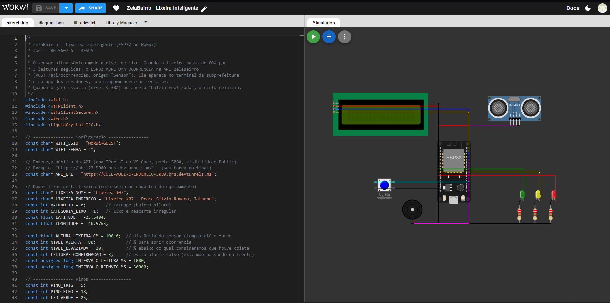
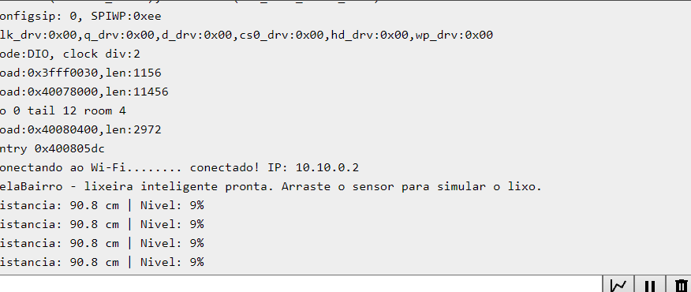
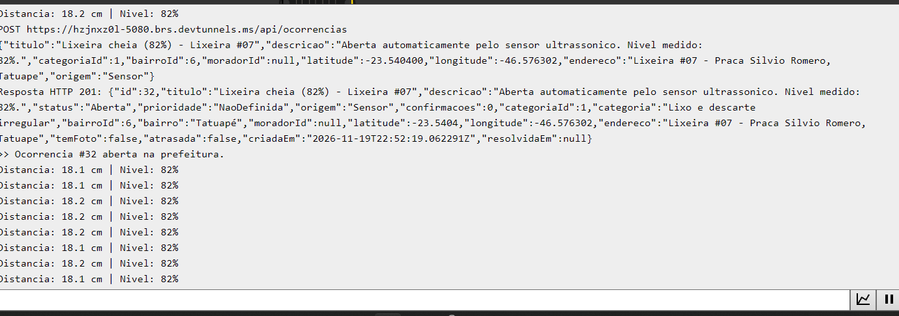

# ZelaBairro — Lixeira inteligente (Physical Computing: IoT & IoB)

| | |
|---|---|
| **Integrante** | Joel Barra Chuquimia — RM 560796 — 3ESPS (trabalho individual) |
| **Projeto no Wokwi** | https://wokwi.com/projects/481071704851898369 |
| **Vídeo demonstrativo** | https://youtu.be/oTze2mCvIOY |
| **Solução completa** | [README principal do ZelaBairro](../README.md) |

## Imagens da montagem
| Circuito no Wokwi | Wi-Fi conectado | Ocorrência aberta na API (HTTP 201) |
|---|---|---|
|  |  |  |

## Como o circuito entra na solução
O ZelaBairro depende de alguém **ver e registrar** o problema. Lixo acumulado é a categoria mais frequente e a de prazo mais curto (3 dias), mas muitas vezes ninguém reclama até virar foco de ratos e mosquitos.

A **lixeira inteligente** elimina essa dependência: um ESP32 mede o nível de lixo e, ao passar de **80%**, **abre sozinho uma ocorrência na API ZelaBairro** (`POST /api/ocorrencias`, origem `Sensor`). A ocorrência aparece:
- no **terminal da subprefeitura** (WinForms), com origem "Sensor", e o **modelo de ML** considera "medido por sensor" na previsão de prioridade;
- no **app dos moradores**, como "📡 Sensor".

Não é um projeto paralelo: é **mais uma porta de entrada de dados** da mesma CitizenTech, ao lado do app (morador) e do balcão (operador).

```
[HC-SR04] → ESP32 → Wi-Fi → API ZelaBairro (Oracle) → Terminal da subprefeitura + App
                ↓
        LCD + LEDs + buzzer (aviso local)
```

## Componentes e ligações
| Componente | Função | Pinos no ESP32 |
|---|---|---|
| Sensor ultrassônico HC-SR04 | Mede a distância até o lixo (na tampa) | TRIG → D5, ECHO → D18, VCC → VIN |
| LCD 16x2 I2C | Nível (%) e status (OK, quase cheia, nº da ocorrência, API offline) | SDA → D21, SCL → D22 |
| LEDs verde/amarelo/vermelho + 220 Ω | Nível: < 50% / 50–79% / ≥ 80% | D25 / D26 / D27 |
| Botão "Coleta realizada" | O gari confirma que esvaziou (reinicia o ciclo) | D4 (INPUT_PULLUP) |
| Buzzer | Bipa ao abrir a ocorrência e ao confirmar a coleta | D19 |

## Lógica (`sketch.ino`)
1. Mede a cada 1 s: `nível = (altura da lixeira − distância) ÷ altura`.
2. **Anti-alarme falso:** só considera cheia após **3 leituras seguidas** ≥ 80% (ex.: uma mão passando na frente não dispara).
3. Cheia confirmada → `POST` na API com categoria Lixo, bairro, coordenadas e endereço fixos da lixeira. Mostra **"Ocorrencia #N"** no LCD.
4. **Uma ocorrência por ciclo:** não abre outra enquanto a lixeira não for esvaziada.
5. **API fora do ar:** mostra "API offline" e tenta de novo a cada 30 s.
6. **Esvaziou** (nível < 30%) ou botão "Coleta realizada" → reinicia o ciclo.

## Como rodar

### 1. Montar no Wokwi
1. Acesse [wokwi.com](https://wokwi.com) → **New Project → ESP32**.
2. Substitua o conteúdo de `sketch.ino` e `diagram.json` pelos deste repositório.
3. Aba **Library Manager** → **+** → adicione **LiquidCrystal I2C**.
4. **Save** e copie o link do projeto.

### 2. Deixar a API acessível para o Wokwi
O Wokwi roda na nuvem e não enxerga o `localhost` do PC. Use o encaminhamento do VS Code:
1. Rode a API: `cd api/ZelaBairro.Api` e `dotnet run`.
2. No VS Code, aba **Ports** (ao lado de Terminal) → **Forward a Port** → `5080` (pede login no GitHub).
3. Clique com o botão direito na porta → **Port Visibility → Public**.
4. Copie o endereço (ex.: `https://abc123-5080.brs.devtunnels.ms`) e cole em `API_URL` no `sketch.ino`, **sem barra no final**.

### 3. Testar
1. Clique em ▶ no Wokwi. O Serial Monitor mostra a conexão.
2. Clique no sensor ultrassônico e arraste a distância para **menos de 20 cm** (lixeira com mais de 80%).
3. Após 3 s: LCD mostra **"Ocorrencia #N"**, LED vermelho aceso, 2 bipes.
4. No terminal da subprefeitura, clique em **Atualizar**: a ocorrência aparece com origem **Sensor**.
5. Arraste a distância de volta para cima de 70 cm (ou aperte o botão azul) e veja **"Coleta OK!"**.

## Roteiro do vídeo (até 4 min)
1. **(0:00–0:40)** A solução ZelaBairro e o problema do lixo acumulado.
2. **(0:40–1:30)** O circuito no Wokwi: cada componente e por que está ali.
3. **(1:30–3:00)** Demonstração: encher a lixeira → "CHEIA 1/3, 2/3, 3/3" → ocorrência aberta → mostrar no terminal da subprefeitura (e no app) com origem Sensor e a previsão do ML.
4. **(3:00–3:40)** Esvaziar / botão "Coleta realizada" e o caso "API offline".
5. **(3:40–4:00)** Valor para o cidadão: o problema é registrado antes de alguém precisar reclamar.
